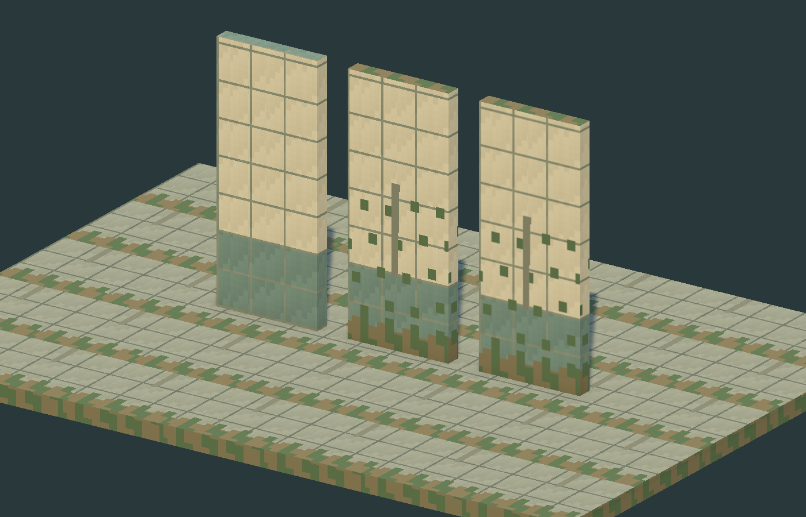
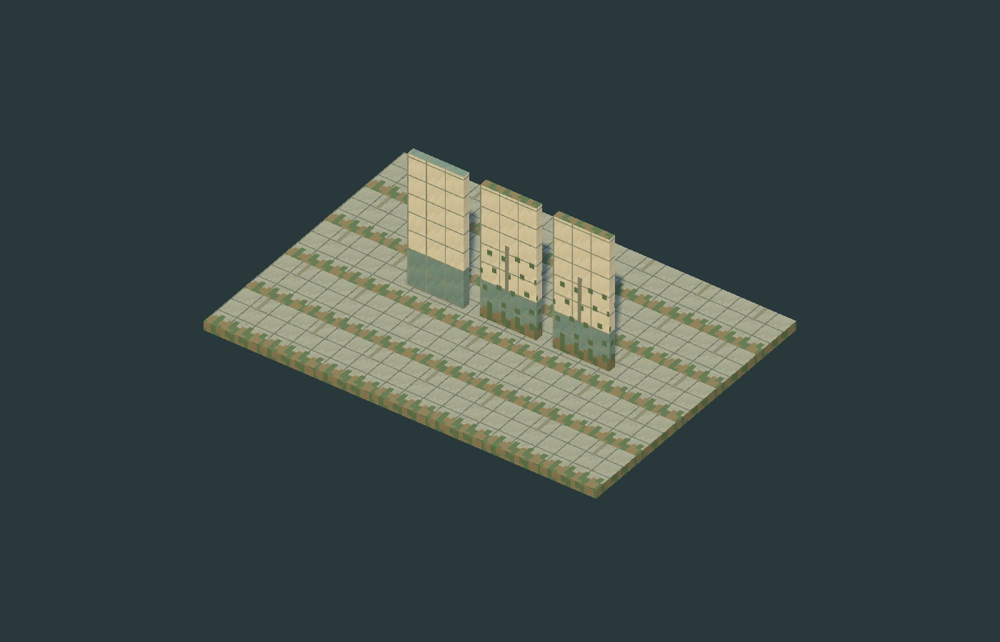

# [M0-ART-01] 풀 3D 모듈형 아트 파이프라인 보고서

기준일: 2026-11-09, Asia/Seoul. 역할: Art Director / Environment Artist / Technical Artist.

**결과: M0 아트 문서·실제 Unity 샘플 제작 완료. 실제 역 통합과 최종 스타일 승인은 별도 검수 대상.** 개발 담당자의 씬·구조 데이터·게임 코드는 수정하지 않았다.

## A. 실제 환경

| 항목 | 확인 결과 |
|---|---|
| Unity | 6000.3.23f1, 프로젝트 버전 유지 |
| Render Pipeline | URP 17.3.0, 실제 렌더 시 UniversalRenderPipelineAsset 확인 |
| CLI | 설치된 Unity CLI 1.0.0-beta.17. 연결이 준비된 뒤 `script run`으로 아트 제작 도구 실행 |
| 실제 렌더 장치 | Direct3D12, NVIDIA GeForce RTX 3050 4GB Laptop GPU |
| Blender/모델링 도구 | Blender MCP 연결 실패. Blender 파일/FBX/GLB는 생성하지 않음. 실제 Mesh는 Unity Editor C# API로 제작 |
| 원본 평면도 | `Docs/mullae-station-layout-v04.pdf` 3쪽 모두 텍스트·렌더 이미지 검토 |
| GDD | `Docs/master gdd.txt`를 우선 읽음. 조사 시작 v1.0, 종료 기준 v1.1과 공통 v0.4 기준서 반영 |
| Grid Specification | 최초에는 없음. 작업 중 추가된 실제 개발 좌표·layout·앵커·generator 코드와 생성된 layout 자산을 읽어 수치 확인. 별도 구두/메시지 전달을 받은 것으로 주장하지 않음 |

GDD v1.1의 채택 기준은 방 01~12와 추가 공간 6개, K1~K8의 밀폐/개방 구분이다. 원본 PDF는 실측 도면이 아니며 1.5m/칸은 시험값이다. 방 용도·보상·위험은 별도 가변 콘텐츠이다.

## B. Art Direction

고요한 폐허, 바랜 타일·콘크리트, 무광 금속, 따뜻한 햇빛, 제한된 초록 군집, 강한 실루엣을 지향한다. 저폴리 메시와 저해상도 질감으로 PS1풍을 구현하며, 참고 이미지의 복제나 화면 왜곡을 필수 요소로 삼지 않는다.

열차는 정리된 안전한 생활 공간, 역은 아름답고 위험한 탐사 공간으로 구분한다. 승객·몬스터·문·획득 대상·공격 준비 자세의 가독성이 장식보다 우선이다. 색상표·명암·시점별 검수·성능 원칙은 [Art Direction](M0_ArtDirection.md)에 정리했다.

## C. Technical Art

현재 코드/자산: 1cell=1.5m, origin=(0,0,0), +Y up, 도면 열 +X/행 -Z, 벽 3.6m×0.22m, 문 높이 2.6m, 바닥 두께 0.25m와 상면 y=0. 문 폭은 portal 데이터에서 받는다.

실측 모델은 scale 1·바닥/상면 중심 피벗을 사용한다. 현행 개발 library가 요구하는 unit-centered bounds 1³ 호환 프리팹도 별도 제공했다. 두 규격을 직접 섞으면 위치·크기 오류가 생기므로 연결 방법을 명시했다. 현행 generator는 Anchor 참조로 별도 CollisionRoot/VisualRoot를 연결한다.

벽은 24 vertices / 12 triangles, 1 submesh, hard normals, 약 64px/m UV0, 256² RGB atlas, 4px dilation. 바닥은 128²이다. Point+Mip On 기준과 동일 그림의 Bilinear 비교를 제공한다. URP Lit, metallic 0, smoothness .05, 추가 PBR map 없음. Import·FBX/GLB 검토·Collider 분리·접합 규약은 [Technical Art Spec](M0_TechnicalArtSpec.md), 전체 범주·예산은 [Module Catalog](M0_ModularAssetCatalog.md)에 있다.

## D. LookDev

실제 생성 경로: `Assets/RinglineArt/M0/`.

| 생성물 | 수량/규격 |
|---|---|
| Mesh | 실측 벽 1.5×3.6×0.22m, 중심 단위 벽, 실측 바닥 1.5×0.25×1.5m 총 3개 |
| Texture | 벽 256² 기본/낡은형/낡은형 Bilinear, 바닥 128² 총 4개 |
| Material | URP Lit 총 4개 |
| Prefab | 실측 벽 기본/낡은형, 실측 바닥, 단위 중심 벽 기본/낡은형 총 5개 |
| 제작 도구 | `Assets/RinglineArt/Editor/M0LookDevBuilder.cs`, Unity 메뉴에서 재생성 가능 |
| 캡처 | `Evidence/M0_Close.png`, `M0_Diorama.png`, `M0_Overview.png`, 각 1400×900 |
| 검사 기록 | `Evidence/M0_Validation.txt` |

실행 결과: C# 메모리 컴파일 diagnostics 0, Unity AssetDatabase 생성·임포트 성공, 지원되는 URP Lit 연결과 렌더 캡처 성공. 실측 피벗·메시 bounds·unit-centered 호환 bounds·렌더 전용 컴포넌트·합성 앵커 교체 전후 Collider identity/size·이전 활성 씬 root 수/dirty flag 보존 검사를 통과했다. 아트 자산만 저장하도록 제작 도구를 제한했다.

**미검증:** 실제 역의 Visual 교체, NavMesh/통행/문 위치 전후 비교, 실제 4방향 카메라 가림, 이동 중 shimmer, GPU 성능·메모리, FBX/GLB 왕복. 정지 스크린샷만으로 이 항목을 PASS로 보고하지 않는다. 기본형과 낡은형의 질감 비교는 가능하지만 반복 이끼 패턴은 M1 개선 대상이다. 기둥·문틀·실제 풀 메시·애니메이션은 이번 생성물에 없다.

## E. Visual 교체 파이프라인

개발 채팅에서 library 사본의 Wall entry에 `PF_Wall_Weathered_UnitCentered`를 연결하고 entry.material을 아트 재질로 바꾸거나 비운다. 기존 entry.material이 남으면 프리팹 재질이 덮어써진다. 실측 `PF_Wall_Weathered_150`은 현행 unit-centered library에 직접 넣지 않는다.

단위 중심 호환본은 현행 방식에 맞는 교체 데모이다. 긴 벽·남북 벽에서는 비균일 스케일로 UV가 늘어나므로 최종 kit로 전체 역에 적용하지 않는다. 개발 측 실측 모듈 반복 배치 또는 크기·방향별 UV 계약이 필요하다. 아트는 개발 함수를 수정하거나 실제 맵을 교체하지 않았다.

통합 시 anchor ID/TRS/size, collision 참조·bounds·layer, 타일/portal/room/K 데이터와 NavMesh 결과를 동일하게 유지한다. 추가 공간 6개·문·승강장 연결을 장식으로 막지 않는다. 합성 fixture 검사는 실제 맵 검증을 대체하지 않는다.

## F. 향후 제작 순서

M1 공용 재질/UV·교체 계약 → M2 열차 3량 → M3 역사 kit/승객 기본형/HUD → M4 승객 이동·운반 애니메이션 → M5 루팅/가구/안전 범위 → M6 운전 패널/풍경 → M7 좌석·초상화·대화 → M8 몬스터 3종 → M9 장소 8종/복도 → M10 나머지 5종/아이템/유물. M11~12에 조명·VFX·성능·스타일을 통합한다.

단계별 선행 데이터·완료 검수·P0~P3 우선순위는 [Production Plan](M0_AssetProductionPlan.md)에 있다.

## G. Git

요청 브랜치: `codex/m0-art-direction`. 변경 범위는 `Docs/Art/`, `Assets/RinglineArt/` 및 해당 폴더 `.meta`이다. 개발 씬·코드·설정·GDD 갱신은 이 작업의 변경으로 포함하지 않는다. 공유 체크아웃의 개발 브랜치를 전환하지 않는다.

제출 시점의 공유 개발 브랜치는 아직 최초 커밋 전이다. 아트 파일만 포함하는 별도 루트 커밋을 만들고 아트 브랜치로 Push한다. 공유 index/개발 branch HEAD를 변경하지 않는다. 이 브랜치는 전체 Unity 프로젝트의 스냅샷이 아니라 아트 전달물이다. 다른 초기 이력에 통합할 때는 필요한 아트 경로를 가져오며, 공통 부모가 있다고 가정하지 않는다.

커밋/Push의 확정 결과와 해시는 최종 채팅 보고 및 해당 브랜치 이력으로 제공한다. 자기 해시를 포함하는 문서의 재커밋 문제를 피하기 위해 이 문서에 동일 커밋의 해시를 하드코딩하지 않는다.

## H. 총괄 검수 요청

- 현재 치수·64px/m·palette·URP Lit 기반을 M1 시작 규격으로 채택할지 검토.
- 현행 unit-centered 호환과 향후 실측 모듈 배치의 책임 경계, 긴 벽/남북 벽의 UV 처리 합의.
- 실제 역 단일 앵커 교체 전후의 구조/문/NavMesh/통행 비교를 개발 측에서 수행.
- 4방향 가림·낮밤·이동 shimmer·식생 envelope·플랫폼 높이·천장 규격 검수.
- 추가 공간의 방 안전 예외 적용 경계, 목표 하드웨어/해상도/FPS, DCC 및 FBX/GLB 왕복 환경 확정.

이 보고서는 아트 샘플의 제작·검사 결과다. 전체 M0 역 구현의 완료 승인이나 게임플레이 검수 PASS를 부여하지 않는다.
