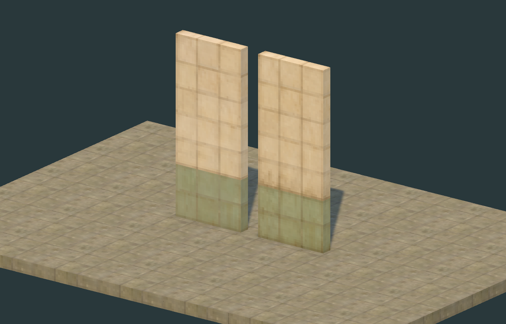
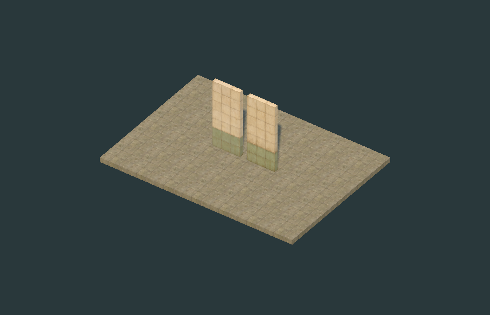

# 《순환선》 M0 Art Direction

기준일: 2026-11-09 | 상태: M0 작업 규격 제안, 최종 아트 승인 전

## 기획 우선순위와 실제 원본

1. 사용자 지시와 `Docs/master gdd.txt` Master GDD v1.1을 게임 규칙의 우선 기준으로 삼는다.
2. `Docs/mullae-station-layout-v04.pdf` 3쪽을 모두 렌더링해 검토했다. 위치·비율의 원본이며 실제 역의 실측 도면은 아니다.
3. 개발 중인 `Assets/Ringline/Runtime/Stations` 및 `Editor/StationAuthoring` 코드의 좌표·앵커 계약을 읽었다. 아트가 이 파일이나 개발 씬을 수정하지 않는다.

**공통 공간 기준:** 조사 시작 시의 GDD v1.0과 PDF에 차이가 있었으나, 작업 중 공유 GDD가 v1.1로 갱신되고 `Docs/M0/M0_LAYOUT_BASELINE_v04.md`가 추가되어 PDF v0.4 채택이 문서화되었다. 현재 기준은 방 01~12, 추가 공간 K3-A/K4-A/B/K5-A/B/K6-A, K1~K8의 실제 밀폐 영역이다. K3~K6 전체를 솔리드로 채우지 않는다. PDF의 공간 이름은 GDD 11장의 원정별 용도 배정을 고정하는 이름으로 사용하지 않는다. GDD 22장의 안전 범위는 실제 통행 경로 기준 약 6m이며 추가 공간 개방으로 자동 확대되지 않는다. 추가 공간의 방 안전 예외 적용 경계는 별도 검토한다. 현재 개발 JSON은 `policy: source-v04`이다.

## 시각적 목표

고요한 도시 폐허, 햇볕에 바랜 타일, 녹슨 산업 설비, 자연의 재점유, 사람이 남긴 생활 흔적. 아름다움과 쓸쓸함을 함께 표현한다. 참고 작가의 구도·이미지를 복제하지 않는다. 멸망 원인을 설명하는 장식이나 국가를 단정하는 실제 로고·역명은 제작하지 않는다.

PS1풍은 단순한 메시와 낮은 해상도의 질감으로 구현한다. 텍스처는 사용자 지시에 따라 **실사 기반 원본을 낮은 해상도로 뭉갠 뒤 어색해진 디테일만 국소 리터칭**한다. 최종 샘플은 ImageGen 실사풍 원본을 벽 32×77px, 바닥 32×32px로 축소했다. 플레이 화면에서 도트가 보이도록 Point 필터를 사용하되, 사진의 큰 얼룩·색 덩어리와 부드러운 줄눈을 보존한다. 격자가 너무 선명해지도록 선을 다시 그리지 않고 낮아진 해상도의 기존 픽셀에 맞춰 조금씩만 손댄다. 화면 전체의 강제 저해상도, 버텍스 흔들림, affine UV 왜곡은 M0에서 도입하지 않는다. 출입문·승객·몬스터의 준비 동작을 읽는 데 도움이 되는 선명도를 유지한다.

## 색채·형태·명암

| 역할 | 제안 색 | 사용 원칙 |
|---|---|---|
| 바랜 콘크리트·타일 | `#B8B39B` | 넓은 중간 명도, 작은 색차의 큰 얼룩 |
| 옛 벽 하단 띠 | `#637C73` | 시설의 수평 기준선, 통로를 가르는 선으로 오인시키지 않음 |
| 바닥 | `#81887A` | 인물 발끝·아이템보다 낮은 대비 |
| 이끼 | `#4C6342` | 가장자리와 습한 면에 군집, 전면 무작위 노이즈 금지 |
| 녹·흙 | `#6F684A` | 금속 접합과 누수 흔적 중심 |
| 그림자·설비 | `#29383B` | 검정으로 뭉개지지 않도록 보조광으로 형태 보존 |
| 기능성 표식 | 밝은 크림·청록 계열 | 문·상호작용 대상에 제한, 최종 UI 색과 별도 조율 |

표의 색은 샘플의 sRGB 색상 기준이며 조명 후 화면 픽셀값은 다르다. 환경의 큰 명암 덩어리를 먼저 만들고 균열·풀·배관을 추가한다. 베벨은 실루엣에 필요한 모서리에만 사용한다. 공통 재질은 무광 중심이다.

## 열차와 역의 구분

열차는 안전한 생활 기반이다. 수평으로 정리된 형상, 관리된 손잡이·패널, 따뜻한 실내광과 개인 물품으로 안정감을 준다. 전투용 방벽·열차 HP·수리 손상 단계는 만들지 않는다. 1호차 운전·관제, 2호차 지정 좌석, 3호차 공용 창고를 기능과 형태로 구분한다. 좌석 수·차체 길이는 미확정이다.

역은 햇빛·그림자·식생·빈 공간의 대비로 탐험 욕구를 만든다. 위험은 환경 전체의 공포 연출보다 생명체 실루엣과 행동에서 읽힌다. 상점은 카운터 1개, 진열대 1~2개, 상인의 공통 문법을 공유한다. 가구·상인·물자는 고정 건축과 별도 콘텐츠이다.

## 카메라와 가독성 검수

| 시점 | 검수 내용 | M0 결과 |
|---|---|---|
| 전체 역 지도 | 방·외곽·K구조물·문과 길을 식별, 가변 미확인 콘텐츠 비공개 | 실제 역 아트 교체는 미실시 |
| 탐사 디오라마 | 조 주변 약 6m보다 넓은 화면, 네 방향 회전에서 가림·실루엣 확인 | 별도 샘플의 세로 시야 14m 정사영 캡처만 실시 |
| 근접 재질 비교 | 기본형/낡은형, Point/Bilinear, 줄눈·픽셀 크기 | 1400×900 정지 캡처 확인 |
| 열차 1인칭 | 손잡이·조종 패널·좌석·물품의 접근 거리와 형태 | M2 선행 검수 항목 |

샘플 디오라마의 14m는 GDD의 반경 6m를 확정하는 카메라 설계가 아니라 비교용 시야이다. 실제 경사 시점의 지면 투영 영역은 카메라 피치·화면비에 따라 달라진다.

벽을 낮추거나 천장을 삭제해 충돌·시야 규칙을 바꾸지 않는다. 필요하면 **Visual만** 숨기는 벽/천장 가림 정책을 개발 담당자와 설계한다. 정적 구조물을 시각적으로 숨겨도 문·충돌·시야 데이터는 유지한다. M0에는 가림 기능을 구현하지 않았다.

식생은 화면의 이동로와 문 폭을 침범하지 않는 군집부터 배치한다. 통행 가능한 공간에 큰 줄기·잔해를 보이게 두어 보이지 않는 충돌과 모순을 만들지 않는다. 특수공격은 GDD대로 준비 자세로 읽히게 하며 빨간 범위 도형을 추가하지 않는다. 미지의 존재의 실제 모습은 M0에서 확정하지 않는다.

## 성능과 스타일의 합격 기준

- 한 모듈의 재질은 기본 1개, 투명 블렌딩보다 불투명·Alpha Clip 우선.
- 메시와 재질을 재사용하고 식생의 겹친 알파 면적을 줄인다. SRP Batcher와 GPU Instancing은 실측으로 경로를 확인한다.
- 후속 목표는 대표 하드웨어·목표 해상도·목표 FPS가 합의된 뒤 수치화한다. 현재 샘플의 RTX 3050 렌더 결과를 게임 성능 보증으로 사용하지 않는다.
- 기존의 반복 이끼 띠는 실사 기반 텍스처로 교체했다. M1에서 반복 연결과 배치 변형을 검토하며, 자잘한 무작위 노이즈로 반복을 숨기지 않는다.

## 실제 비교 이미지

왼쪽은 기본형 Point, 오른쪽은 낡은형 Point. 각 벽의 실제 크기는 1.5×3.6×0.22m이다. Bilinear 비교는 `Evidence/M0_FilterComparison.png`에 별도 보관한다.

